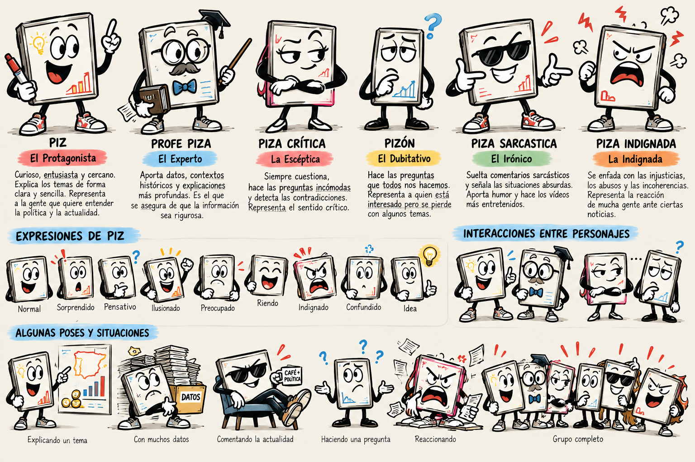
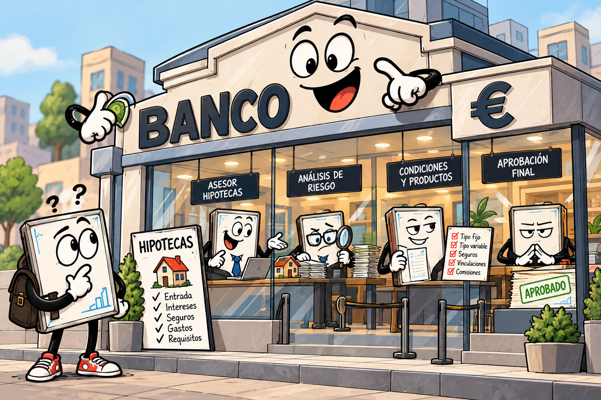
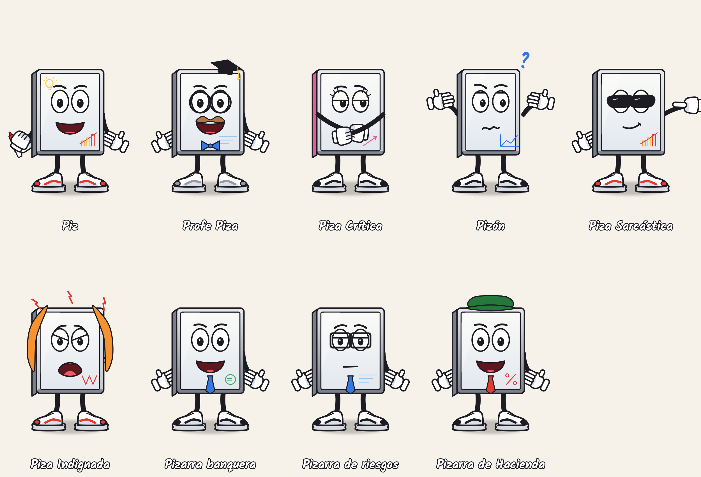
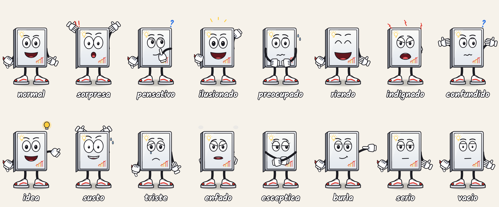
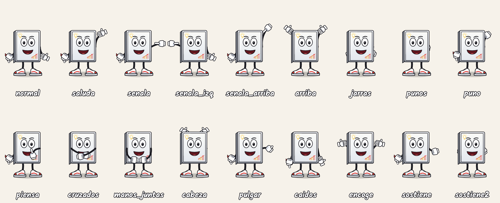
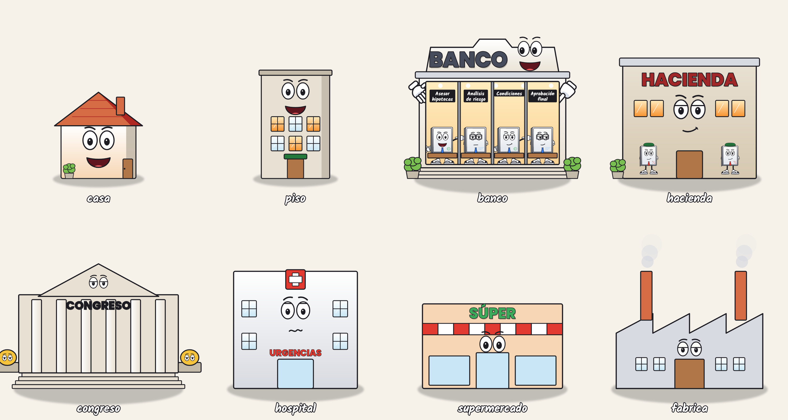
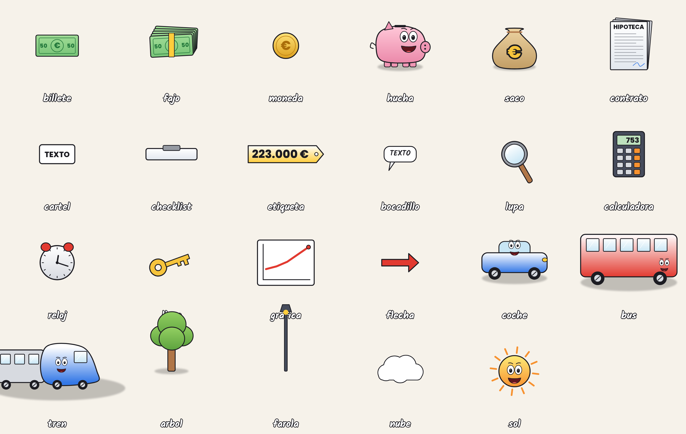
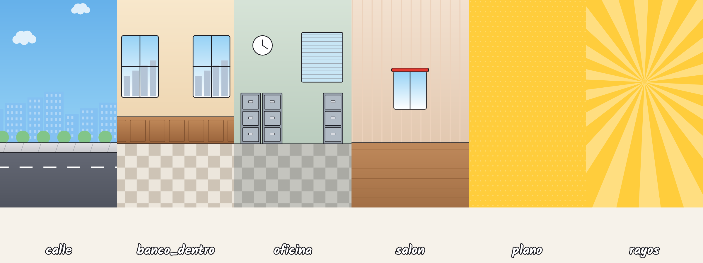

# Identidad visual oficial de Pizarra Pública

**Desde el 14 de octubre de 2026, todos los vídeos usan este universo:** pizarras blancas con vida propia en un mundo cartoon 2D. Este estilo sustituye al monigote a lápiz «TÚ» y a la pizarra solo con dibujos a lápiz. El ritmo y el guion siguen las reglas de [docs/enganche.md](../enganche.md).

Las referencias que mandó joel son la guía permanente del estilo:

| | |
|---|---|
|  |  |

Las hojas de modelo que hay más abajo salen del código y se regeneran con `python3 pipeline/universo/fichas.py`.

## 1. Reglas de estilo

- **Contorno negro definido.** Usa `GROSOR = 6` a escala 1 y no lo cambies.
- **Colores vivos pero equilibrados.** Salen siempre de la paleta `COL` de `pipeline/universo/estilo.py` y nunca se escriben a mano.
- **Volumen suave.** Cada pieza lleva un degradado y una sombra interior, más un brillo cuando toca. Todo apoya en el suelo con una sombra difuminada.
- **Caras exageradas.** Los ojos son grandes con pupila y párpado, las cejas son muy expresivas y la boca es abierta con lengua.
- **Todo tiene cara** cuando ayuda a contar: casas, el banco, Hacienda, billetes, la hucha, el contrato, coches, trenes o el sol.
- **Prohibido:**
  - monigotes de palitos;
  - iconos genéricos;
  - imágenes pegadas como fondo estático;
  - personajes que cambian de diseño entre vídeos.
- **Personajes siempre iguales.** Su ficha (`PERSONAJES` en `personajes.py`) es la única fuente. Si un personaje cambia, cambia en la ficha y afecta a todos los vídeos.
- **Rótulos cartoon.** Son letras gordas con contorno negro y sombra (`rotulo`). Ya no se usa la letra a lápiz.
- **Margen seguro.** El contenido va entre x = 130 y 950, porque la cámara se mueve y recorta los bordes. La franja de y = 1400 a 1700 es para los subtítulos y las fuentes.

## 2. Personajes



| Clave | Nombre | Papel | Rasgos fijos |
|---|---|---|---|
| `piz` | **Piz** | Protagonista (el joven, «tú») | Rotulador rojo en la mano izquierda, bombilla y barras en la pizarra, zapatillas rojas |
| `profe` | **Profe Piza** | El experto que explica | Gafas redondas, bigote, pajarita azul, birrete |
| `critica` | **Piza Crítica** | La escéptica | Canto rosa, pestañas, brazos cruzados |
| `pizon` | **Pizón** | El que duda | Más estrecho, gráfica azul, interrogación |
| `sarcastica` | **Piza Sarcástica** | La irónica | Gafas de sol, media sonrisa |
| `indignada` | **Piza Indignada** | La que estalla | Melena naranja, rayos de enfado |
| `banquero` / `banquera_seria` | Pizarras banqueras | Trabajan en el banco | Marco oscuro, corbata azul, gafas cuadradas (riesgos) |
| `hacienda` | Pizarra de Hacienda | Cobra impuestos | Visera verde, corbata roja, «%» |

**Caras** (`cara`): normal, sorpresa, pensativo, ilusionado, preocupado, riendo, indignado, confundido, idea, susto, triste, enfado, esceptica, burla, serio y vacio.



**Poses** (`pose`): si no se fija ninguna, la pose sigue a la cara. Las disponibles son normal, saluda, senala, senala_izq, senala_arriba, arriba, jarras, punos, puno, piensa, cruzados, manos_juntas, cabeza, pulgar, caidos, encoge, sostiene y sostiene2.



## 3. Mundo: edificios, objetos y fondos



**Edificios** (`edificio`): casa (con `variante` moderna o antigua), piso, banco (con 4 pizarras banqueras dentro y carteles «Asesor hipotecas · Análisis de riesgo · Condiciones · Aprobación final»), hacienda, congreso, hospital, supermercado y fabrica.



**Objetos** (`objeto`):

- **Dinero:** billete, fajo, moneda, hucha, saco.
- **Papeles y rótulos:** contrato, cartel, checklist, etiqueta, bocadillo.
- **Herramientas y datos:** lupa, calculadora, reloj, llave, grafica, flecha.
- **Transporte:** coche, bus, tren.
- **Calle y cielo:** arbol, farola, nube, sol.



**Fondos** de escena (`fondo`): calle (con cielo, nubes que se mueven, ciudad lejana, acera y calzada), banco_dentro, oficina, salon, plano (color con trama) y rayos (para los golpes y el final). El suelo está en y = 1340.

## 4. Cómo se usa en un storyboard

El estilo se activa con `"estilo": "viva"` y con `"fondo"` en cada escena. Cada pieza es un elemento independiente y animable:

```json
{"type": "personaje", "quien": "piz", "x": 290, "y": 1340, "scale": 1.0, "at": 0,
 "cara": "ilusionado", "entra": "pop",
 "acciones": [{"at": "@fijo", "pose": "pulgar"},
              {"at": "@ahorrando", "salta": true, "cara": "riendo"},
              {"at": "@no", "cara": "susto", "tiembla": true},
              {"at": "@banco", "x": 600, "dur": 0.9},
              {"at": "@tiene", "objeto": "hucha", "pose": "sostiene"}]}
{"type": "edificio", "edificio": "banco", "x": 600, "y": 1340, "scale": 0.85, "entra": "cae",
 "acciones": [{"at": "@resto", "cara": "burla", "caras_dentro": {"0": "burla", "3": "serio"}}]}
{"type": "objeto", "objeto": "etiqueta", "props": {"texto": "223.000 €"}, "x": 680, "y": 560, "entra": "cae", "golpe": true}
{"type": "rotulo", "text": "FALTAN 46.900 €", "x": 540, "y": 600, "size": 104, "color": "red", "golpe": true}
```

- **Entradas:** `pop`, `izq`, `der` (entra andando), `cae` (con aplastamiento al tocar el suelo), `abajo` y `crece` (edificios). Para que no tenga entrada, usa `nada`.
- **Acciones** (cada una con `at`, que puede anclarse a una palabra de la voz, `@palabra`):
  - `cara`, `pose` y `mira`;
  - `x`/`y` con `dur` (anda hasta ahí);
  - `salta`, `tiembla` y `sale` (`izq`, `der`, `pop` o `abajo`);
  - `objeto` (lo sostiene en la mano) y `props` (cambia el objeto: texto, marcas…);
  - `caras_dentro` (para los trabajadores del banco), `habla` (la boca se mueve con la voz) y `sfx`.
- **Vida automática:**
  - el personaje respira y parpadea;
  - estira y encoge al cambiar de cara;
  - anda al desplazarse;
  - las ruedas giran, el humo sube y las nubes se mueven.
- **Sonido automático:** pop al entrar, whoosh si entra por un lado, impacto si cae, boing si salta y `sfx` a demanda (error, ding, caja, subida…).
- **Efectos de siempre** sobre cualquier elemento: `fx` (`tachar`, `rodear`, `latir`, `temblar`, `mover`, `golpe`, `borrar`), `golpe: true` y `out`.

La plantilla es `pipeline/series/compra2026_universo.py` («Piz quiere comprarse una casa»).

## 5. Guion visual tipo

La historia la cuenta **Piz** viviéndola. Cada dato es un obstáculo físico al que reacciona.

1. **Gancho (0-2 s):** Piz ilusionado ya en pantalla en el fotograma 0. Enseguida llega el giro que le hunde.
2. **El deseo:** la casa sonriente.
3. **El primer golpe:** el precio cae como una etiqueta y Piz se asusta.
4. **El viaje:** Piz va al banco y dentro esperan las pizarras banqueras.
5. **Los obstáculos:** condiciones, impuestos y gastos aparecen como carteles que caen uno tras otro, con una reacción distinta a cada uno.
6. **El giro absurdo:** con corte de música.
7. **El final:** la conclusión emocional y la pregunta de la próxima entrega (PSOE, PP y Vox), más «Síguenos».

Los secundarios aparecen como cameo para reaccionar: Sarcástica se burla, Indignada estalla, Pizón duda y Profe Piza explica un dato difícil.

## 6. Limitaciones y cómo crecer

- **Qué es y qué no es.** El universo se dibuja con vectores en código (skia), así que es animable al 100 % y consistente de un vídeo a otro. No es pintura digital. Las referencias tienen más textura y detalle de ilustrador (reflejos, texturas, muchos objetos de atrezo). Nuestro resultado es más limpio y algo más simple.
- **Animación por piezas.** Hay brazos «de manguera», pasos, saltos y cambios de cara, pero no animación fotograma a fotograma como en un estudio.
- **Siguiente salto de calidad (opcional).** Consiste en generar recursos ilustrados con IA, por ejemplo el API de imágenes de Gemini, que sí es accesible desde aquí.
  - Se generarían fondos detallados y atrezo a partir de las referencias.
  - Se usarían como capas fijas detrás de los personajes vectoriales, que seguirían siendo los mismos.
  - Hace falta una clave de API de Google AI Studio y revisar a mano la consistencia de cada fondo.
- **Cómo añadir una pieza nueva.** Escribe una función en `edificios.py`, `objetos.py` o `fondos.py`. Usa `pieza()`, `suave()`, `degradado()` y la paleta. Regístrala en `TIPOS` y `TAMANO` y vuelve a generar las fichas.
